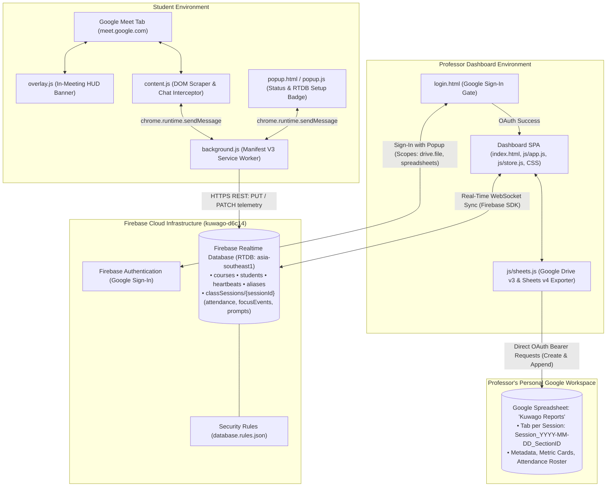
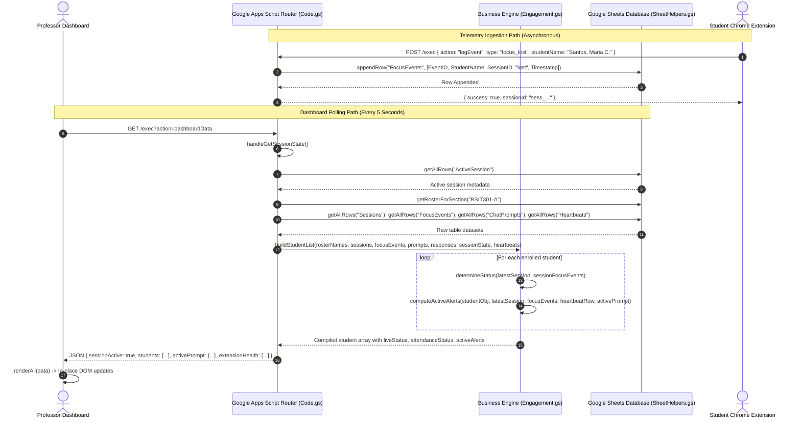
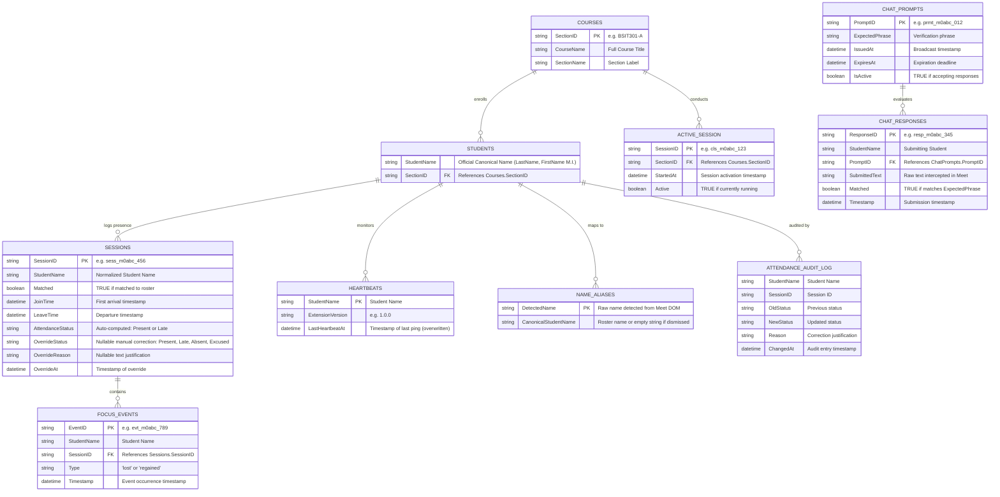
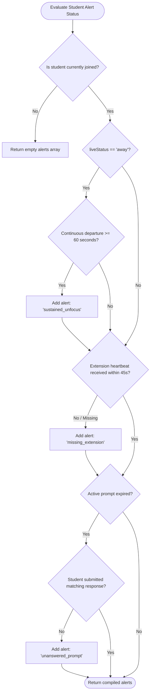
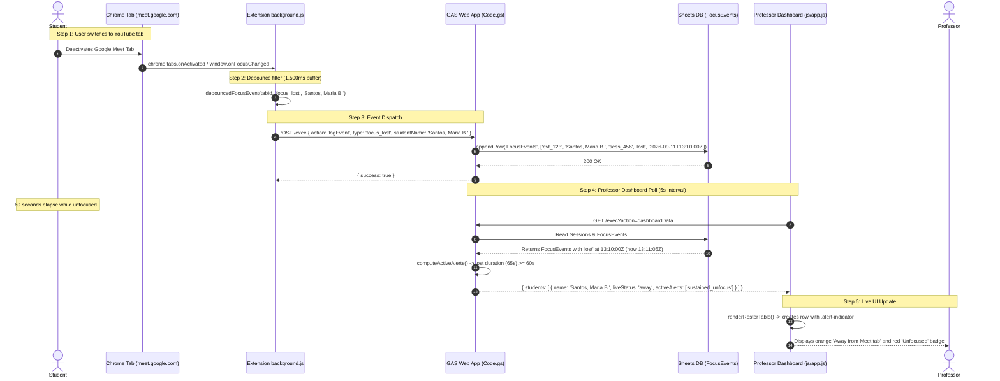

# Kuwago Codebase Technical Documentation

> **File:** `CODEBASE_EXPLAINED.md`  
> **Repository:** `lester27/Kuwago` (Version 3.0.0)  
> **Target Audience:** Software engineers onboarding to this codebase who need to understand the concrete technical implementation, request lifecycles, database structures, and runtime mechanics.

---

## Table of Contents
1. [Project Overview](#1-project-overview)
2. [Repository Structure](#2-repository-structure)
3. [Architecture Deep Dive](#3-architecture-deep-dive)
4. [Backend Walkthrough](#4-backend-walkthrough)
5. [Frontend Walkthrough](#5-frontend-walkthrough)
6. [Database & Storage Engine](#6-database--storage-engine)
7. [Data Flow Example (End-to-End Trace)](#7-data-flow-example-end-to-end-trace)
8. [Configuration, Environment & Deployment](#8-configuration-environment--deployment)
9. [Testing & Quality Assurance](#9-testing--quality-assurance)
10. [Glossary, Inconsistencies & Gotchas](#10-glossary-inconsistencies--gotchas)

---

## 1. Project Overview

### 1.1 Core Problem and User Personas
In remote and hybrid university classes using Google Meet, professors face several visibility challenges:
1. **Superficial Attendance:** Students join a call, mute audio/video, and switch to other applications or browser tabs for the remainder of the class period.
2. **Identity Mismatch:** Google Meet display names often reflect personal Google accounts (e.g., nicknames, first names only, or inverted name formats) rather than official institutional roster formats (`LastName, FirstName M.I.`), forcing professors to perform manual reconciliation.
3. **Passive Engagement:** Professors lack low-friction mechanisms to verify live presence during lectures without interrupting discussion flow.

**Kuwago** solves these problems through a distributed architecture composed of four integrated layers:
- A **Chrome Extension (Manifest V3)** running on student machines that monitors tab focus, detects identity from the Google Meet DOM, presents in-meeting verification overlays (`overlay.js`), captures chat responses, and streams health heartbeats.
- A **Realtime Database Backend (Firebase RTDB)** in `asia-southeast1` that powers sub-second reactive state synchronization across WebSockets and receives extension REST writes without API gateways.
- An **Authentication & Export Engine** utilizing **Firebase Authentication (Google Sign-In)** to secure the dashboard and directly drive the **Google Drive API v3** and **Google Sheets API v4**, generating formatted reports in the professor's own Google Drive ("Kuwago Reports").
- A **Professor Dashboard (Vanilla ES Modules SPA)** deployed on Vercel (or served locally) displaying real-time attendance, active alerts (sustained unfocus, missing extension, unanswered prompts), manual attendance override controls, and interactive prompt dispatchers.

### 1.2 Tech Stack & Concrete Versions
Verified directly from package and configuration manifests:

| Layer | Technology | Version / Endpoint | Purpose |
|---|---|---|---|
| **Hosting & CDN** | Vercel Platform | Zero-config static web app (`vercel.json`) | Production hosting at `kuwago-dashboard.vercel.app` with clean URLs and security headers. |
| **Local Web Server** | Node.js Runtime | `>= 18.0.0` (from `package.json` engines) | Serves the static dashboard locally via zero-dependency HTTP server (`serve-dashboard.js`). |
| **Admin & Seeding** | Firebase Admin SDK | `^12.7.0` (`package.json` devDependencies) | Automated seeding of sections (`BSIT 3-5`) and student rosters via `scripts/seed-rtdb.js`. |
| **Realtime Database** | Firebase RTDB | `asia-southeast1` regional instance | Primary live telemetry store (`kuwago-d6c14-default-rtdb.asia-southeast1.firebasedatabase.app`). |
| **Authentication** | Firebase Auth (Google) | Web Compat SDK v11 | Google OAuth Sign-In gate with Drive and Sheets authorization scopes. |
| **Report Storage** | Google Drive & Sheets API | Drive v3 & Sheets v4 REST API | Directly creates and updates per-session tabs in the professor's "Kuwago Reports" spreadsheet. |
| **Frontend Framework** | Vanilla JavaScript | ES2022+ (Native ES Modules) | SPA architecture without React, Vue, or build-step bundlers. |
| **Frontend Styling** | Vanilla CSS | CSS3 Variables | Design system located in `css/tokens.css`, `css/layout.css`, `css/components.css`, `css/states.css`, `css/login.css`. |
| **Typography** | Google Fonts | Web Font API | Plus Jakarta Sans (UI text) & JetBrains Mono (timestamps, counters). |
| **Client Extension** | Chrome Extensions API | Manifest V3 | Service worker (`background.js`), Content Script (`content.js`), and HUD (`overlay.js`). |

### 1.3 High-Level System Topology



---

## 2. Repository Structure

```
Professor Dashboard/
├── .agents/                               # Antigravity agent configuration and custom skills
├── .gemini/                               # IDE and agent customization data
├── firebase/                              # Firebase configuration and rules
│   └── database.rules.json                # RTDB security rules (scoped reads/writes)
├── scripts/                               # Administrative and database management scripts
│   ├── seed-rtdb.js                       # Node.js script seeding courses and student rosters
│   └── serviceAccountKey.json             # Firebase service account credentials (git-ignored)
├── chrome-extension/                      # Student Chrome Extension (Manifest V3)
│   ├── icons/                             # Extension icons in 16x16, 48x48, 128x128 PNG and SVG formats
│   ├── background.js                      # Service worker: focus listener, tab lifecycle, RTDB REST client
│   ├── content.js                         # Content script: DOM identity detection, chat listener, keepalive
│   ├── overlay.js                         # In-meeting HUD prompt banner injected into Google Meet
│   ├── manifest.json                      # Extension Manifest V3 configuration, permissions, host rules
│   ├── popup.html                         # Extension popup interface markup and styles (royal blue theme)
│   └── popup.js                           # Extension popup logic (queries background worker for live status)
├── css/                                   # Standalone Dashboard CSS design system
│   ├── components.css                     # Cards, data tables, buttons, badges, modals, form controls
│   ├── layout.css                         # Application shell, sidebar, topbar, grid layout, responsive breakpoints
│   ├── states.css                         # Loading skeletons, status colors, urgent countdown animations, transitions
│   ├── tokens.css                         # Design tokens: palette, typography scale, spacing, border radii, shadows
│   └── login.css                          # Dedicated styles for Google Sign-In login portal
├── docs/                                  # Project technical documentation and guides
│   ├── api-reference.md                   # HTTP and RTDB data contract documentation
│   ├── apps-script.md                     # Reference documentation on legacy Apps Script export
│   ├── architecture.md                    # System architecture, data flow diagrams, database schemas
│   ├── chrome-extension.md                # Chrome extension technical design and DOM scraper reference
│   ├── README.md                          # Documentation index
│   └── setup-guide.md                     # Comprehensive step-by-step setup walkthrough
├── js/                                    # Standalone Dashboard client application (ES Modules)
│   ├── app.js                             # Application bootstrapper: auth guard, store binding, event routing
│   ├── login.js                           # Google Sign-In authentication handler and token persistence
│   ├── firebase.js                        # Firebase SDK initialization, Auth state, RTDB refs, token manager
│   ├── store.js                           # Real-time RTDB listener coordinator and client-side reactive store
│   ├── api.js                             # Data operations layer (RTDB mutations, mock mode fallbacks)
│   ├── sheets.js                          # Direct Google Drive v3 & Google Sheets v4 API exporter
│   ├── session.js                         # Class session lifecycle manager (course selection, start/end timer)
│   ├── engagement.js                      # Client-side focus lapse analytics & student detail metric math
│   ├── attendance.js                      # Attendance override modal and unmatched-name resolution controller
│   ├── mock.js                            # Comprehensive offline simulation engine for UI development (?mock=true)
│   ├── prompt.js                          # Prompt issuance modal, input validation, and submission logic
│   ├── render.js                          # Pure DOM renderer for summary cards, tables, badges, and modals
│   └── respondents.js                     # Prompt respondents checklist modal logic
├── spec/                                  # Specifications and design addenda
├── CHANGELOG.md                           # Version history and release notes
├── CODEBASE_EXPLAINED.md                  # This master technical onboarding document
├── CONTRIBUTING.md                        # Guidelines for development, code standards, and PR workflows
├── index.html                             # Primary entry point for the standalone Professor Dashboard SPA
├── login.html                             # Dedicated Google Sign-In login gateway
├── package.json                           # Node.js project manifest (scripts, engines, devDependencies)
├── README.md                              # Repository overview and quick start guide
├── serve-dashboard.js                     # Node.js static file server (http://127.0.0.1:8080)
├── skills-lock.json                       # Lockfile for agent customization dependencies
└── vercel.json                            # Vercel deployment and routing configuration
```

### 2.1 File Purposes & Entry Points

| File / Folder | Type | One-Line Purpose |
|---|---|---|
| `login.html` / `js/login.js` | **Entry Point (Auth)** | Google OAuth Sign-In gate capturing session credentials and Google API access tokens. |
| `index.html` / `js/app.js` | **Entry Point (Dashboard UI)** | Protected dashboard SPA; bootstraps auth guard, attaches RTDB listeners, and renders control views. |
| `js/store.js` | **Data Store** | Establishes WebSocket subscriptions to Firebase RTDB and triggers UI updates upon state changes. |
| `js/sheets.js` | **Exporter Engine** | Directly interacts with Google Drive and Sheets APIs using the professor's bearer token. |
| `serve-dashboard.js` | **Entry Point (Server)** | Zero-dependency Node.js HTTP server hosting the dashboard on port 8080 with path-traversal security. |
| `scripts/seed-rtdb.js` | **Database Utility** | Node.js script using Firebase Admin to seed courses and student rosters. |
| `chrome-extension/manifest.json` | **Entry Point (Extension)** | Declares MV3 permissions, background service worker, content scripts, and host patterns. |
| `chrome-extension/background.js` | **Entry Point (Worker)** | MV3 service worker tracking tab activation, window focus, prompt polling, and RTDB REST logging. |
| `chrome-extension/content.js` | **Entry Point (Page Script)** | Injected into `meet.google.com`; scrapes self-identity, intercepts chat submissions, and manages presence. |
| `chrome-extension/overlay.js` | **Extension HUD** | Displays an on-screen prompt countdown banner directly inside the Google Meet viewport. |
| `chrome-extension/popup.html` | Extension UI | Status window displaying the student's connection state and live RTDB readiness indicator. |tension/background.js` | **Entry Point (Worker)** | MV3 service worker tracking tab activation, window focus, prompt polling, and event dispatching. |
| `chrome-extension/content.js` | **Entry Point (Page Script)** | Injected into `meet.google.com`; scrapes self-identity, intercepts chat submissions, and tracks document visibility. |
| `chrome-extension/popup.html` | Extension UI | Small status window displayed when the user clicks the browser action icon. |
| `apps-script/Engagement.gs` | Logic Engine | Recomputes student live statuses, focus lapse counts, participation percentages, and active alerts. |
| `apps-script/SheetHelpers.gs` | Data Layer / ORM | Implements table creation, row appending, cell updating, name normalization, and string similarity scoring. |
| `apps-script/Index.html` | Legacy Template | Google Apps Script `HtmlService` page for running the dashboard hosted directly inside Google Drive. |
| `js/api.js` | Service Layer | Client-side HTTP transport layer connecting the dashboard to Apps Script or the offline mock engine. |
| `js/render.js` | View Layer | Direct DOM mutation engine updating table rows, cards, badges, and modals without full page repaints. |
| `js/session.js` | Controller | Manages course selection, class session start/end sequences, and the live duration timer. |
| `js/attendance.js` | Controller | Event listeners for manual attendance overrides and unmatched-name resolution dropdowns. |
| `js/mock.js` | Mock Engine | Generates synthetic Filipino student rosters, simulated network latency, and realistic focus events. |

---

## 3. Architecture Deep Dive

### 3.1 Request Lifecycle
The Kuwago system operates across decoupled environments. Because Google Apps Script Web Apps exhibit unique redirect behavior when accessed via browser `fetch()`, requests are categorized into two transport paths:

1. **Dashboard Poll & Mutations (`GET` with Query Parameters):**
   Standard web pages hosted on `localhost:8080` encounter CORS preflight failures when sending cross-origin `POST` requests to Apps Script due to 302 redirects to `script.googleusercontent.com`. Kuwago executes all dashboard queries and mutations via `GET ?action=...`.
2. **Extension Telemetry (`POST` via Chrome Extension Host Permissions):**
   Chrome extensions declaring `host_permissions` for `script.google.com` bypass browser CORS restrictions completely, allowing the background worker to dispatch `POST` requests with JSON payloads directly.



### 3.2 Layering Rationale
The architecture separates concerns into four strict tiers:
- **Presentation & View (`index.html`, `css/*`, `js/render.js`):** Contains zero business calculation logic. It receives pre-formatted view objects and mutates the DOM using cached fragment updates.
- **Client Application State (`js/app.js`, `js/session.js`, `js/attendance.js`, `js/api.js`):** Manages local interval timers, caches the last-known-good API response to tolerate network blips, and tracks modal visibility.
- **Backend Routing & Orchestration (`apps-script/Code.gs`):** Inspects the incoming `action` parameter, extracts query/body arguments, invokes domain functions, and formats HTTP JSON responses using `ContentService`.
- **Domain Business Engine (`apps-script/Engagement.gs`):** Pure stateless functions (`determineStatus`, `computeFocusLapses`, `computeParticipation`, `computeActiveAlerts`). It takes raw table rows and returns computed indicators. Nothing in this file writes to the database.
- **Database Access Object (`apps-script/SheetHelpers.gs`):** Encapsulates the Google Sheets API (`SpreadsheetApp`). Provides table header discovery, array-to-object serialization, row filtering, cell updating, and string normalization.

### 3.3 Database Entity-Relationship Diagram
Drawn strictly from the real schemas defined in `SHEET_SCHEMAS` (`apps-script/SheetHelpers.gs` lines 8–20):



---

## 4. Backend Walkthrough

The backend runs on Google Apps Script under `apps-script/Code.gs`. The application exposes two HTTP dispatcher functions: `doGet(e)` and `doPost(e)`.

### 4.1 Route Catalog

#### Endpoint 1: `GET ?action=getCourses`
- **What it does:** Fetches all course sections registered in the `Courses` sheet for the class selector dropdown.
- **Request Parameters:** None.
- **Response Shape:**
  ```json
  {
    "courses": [
      { "sectionId": "BSIT301-A", "courseName": "IT Capstone Project", "sectionName": "Section A" }
    ]
  }
  ```
- **Source Code (`apps-script/Code.gs` lines 628–637):**
  ```javascript
  // apps-script/Code.gs
  function handleGetCourses() {
    const rows = getAllRows('Courses');
    return {
      courses: rows.map(r => ({
        sectionId:   r.SectionID   || '',
        courseName:  r.CourseName  || '',
        sectionName: r.SectionName || ''
      }))
    };
  }
  ```
- **Code Explanation:** Reads all data rows from the `Courses` sheet using `getAllRows('Courses')`. Maps each spreadsheet row object to camelCase properties (`sectionId`, `courseName`, `sectionName`) ensuring string fallbacks if cells are empty.

---

#### Endpoint 2: `GET ?action=getSessionState`
- **What it does:** Returns the currently active class session if one is running, allowing dashboard refreshes to restore state.
- **Request Parameters:** None.
- **Response Shape:**
  ```json
  {
    "active": true,
    "sessionId": "cls_m0ab12_cd34ef",
    "sectionId": "BSIT301-A",
    "startedAt": "2026-09-11T13:00:00.000Z"
  }
  ```
  *(Or `{ "active": false }` if no class session is in progress).*
- **Source Code (`apps-script/Code.gs` lines 643–660):**
  ```javascript
  // apps-script/Code.gs
  function handleGetSessionState() {
    const rows = getAllRows('ActiveSession');
    if (rows.length === 0) return { active: false };

    const latest = rows[rows.length - 1];
    const isActive = latest.Active === true || latest.Active === 'TRUE';

    if (!isActive) return { active: false };

    return {
      active: true,
      sessionId:  latest.SessionID  || '',
      sectionId:  latest.SectionID  || '',
      startedAt:  latest.StartedAt instanceof Date
        ? latest.StartedAt.toISOString()
        : (latest.StartedAt || '')
    };
  }
  ```
- **Code Explanation:** Queries `ActiveSession`. Since Google Sheets handles booleans inconsistently (sometimes as raw boolean `true`, sometimes as string `'TRUE'`), it validates both types. Formats the `StartedAt` cell to an ISO 8601 string if stored as a native JavaScript Date object.

---

#### Endpoint 3: `GET ?action=startSession&sectionId=...`
- **What it does:** Activates a class session for the provided course section. Rejects if a class is already active.
- **Request Parameters:** `sectionId` (string, e.g., `'BSIT301-A'`).
- **Response Shape:**
  ```json
  {
    "success": true,
    "sessionId": "cls_m0ab12_cd34ef",
    "sectionId": "BSIT301-A",
    "startedAt": "2026-09-11T13:00:00.000Z"
  }
  ```
- **Source Code (`apps-script/Code.gs` lines 666–700):**
  ```javascript
  // apps-script/Code.gs
  function handleStartSession(body) {
    const { sectionId } = body;

    if (!sectionId) {
      return { error: 'Missing sectionId' };
    }

    /* Check for existing active session */
    const current = handleGetSessionState();
    if (current.active) {
      return { error: 'A session is already active. End it before starting a new one.' };
    }

    const sessionId = generateId('cls');
    const now = new Date();

    /* Write to ActiveSession (overwrite — single-row table) */
    const sheet = getOrCreateSheet('ActiveSession');
    const dataRows = sheet.getDataRange().getValues();

    if (dataRows.length > 1) {
      /* Overwrite existing row */
      sheet.getRange(2, 1, 1, 4).setValues([[sessionId, sectionId, now, true]]);
    } else {
      /* Append first row */
      sheet.appendRow([sessionId, sectionId, now, true]);
    }

    return {
      success: true,
      sessionId,
      sectionId,
      startedAt: now.toISOString()
    };
  }
  ```
- **Code Explanation:** 
  1. Validates that `sectionId` was provided.
  2. Ensures only one global active class session exists at any given time.
  3. Generates a unique ID prefixed with `cls_`.
  4. Treats the `ActiveSession` sheet as a single-row singleton table: if row 2 already exists, it updates columns 1 through 4 in place using `setValues()`; otherwise, it calls `appendRow()`.

---

#### Endpoint 4: `GET ?action=endSession&sessionId=...`
- **What it does:** Concludes the active class session: closes open student sessions by stamping `LeaveTime`, deactivates active prompts, sets `ActiveSession.Active = false`, and compiles the permanent session archive sheet.
- **Request Parameters:** `sessionId` (string).
- **Response Shape:**
  ```json
  {
    "success": true,
    "endedAt": "2026-09-11T14:30:00.000Z",
    "summary": {
      "sheetName": "Session_2026-09-11_BSIT301-A",
      "students": [
        {
          "name": "Dela Cruz, Juan A.",
          "timeIn": "2026-09-11T13:02:00.000Z",
          "timeOut": "2026-09-11T14:30:00.000Z",
          "attendance": "Present",
          "focusLapses": 1,
          "awaySeconds": 75,
          "attentivenessPct": 98,
          "answered": 2,
          "issued": 2,
          "participationPct": 100,
          "identityMatched": true
        }
      ]
    }
  }
  ```
- **Source Code (`apps-script/Code.gs` lines 707–758):**
  ```javascript
  // apps-script/Code.gs
  function handleEndSession(body) {
    const current = handleGetSessionState();

    if (!current.active) {
      return { error: 'No active session to end' };
    }

    const sessionId = current.sessionId;
    const sectionId = current.sectionId;
    const now = new Date();

    /* 1. Close all open student sessions (set LeaveTime = now) */
    const sessSheet = getOrCreateSheet('Sessions');
    const sessData = sessSheet.getDataRange().getValues();
    if (sessData.length > 1) {
      const headers = sessData[0].map(String);
      const leaveCol = headers.indexOf('LeaveTime');
      for (let i = 1; i < sessData.length; i++) {
        if (!sessData[i][leaveCol] || sessData[i][leaveCol] === '') {
          sessSheet.getRange(i + 1, leaveCol + 1).setValue(now);
        }
      }
    }

    /* 2. Expire any active prompts */
    const activePrompts = findRows('ChatPrompts', 'IsActive', true);
    for (const p of activePrompts) {
      updateCell('ChatPrompts', 'IsActive', p.rowIndex, false);
    }
    const activePromptsTRUE = findRows('ChatPrompts', 'IsActive', 'TRUE');
    for (const p of activePromptsTRUE) {
      updateCell('ChatPrompts', 'IsActive', p.rowIndex, false);
    }

    /* 3. Mark session inactive */
    const activeSheet = getOrCreateSheet('ActiveSession');
    const activeData = activeSheet.getDataRange().getValues();
    if (activeData.length > 1) {
      const headers = activeData[0].map(String);
      const activeCol = headers.indexOf('Active');
      activeSheet.getRange(2, activeCol + 1).setValue(false);
    }

    /* 4. Generate per-session summary sheet and capture summary */
    const summary = generateSessionSheet(sessionId, sectionId, current.startedAt, now.toISOString());

    return {
      success: true,
      endedAt: now.toISOString(),
      summary
    };
  }
  ```
- **Code Explanation:**
  1. Checks if an active session exists.
  2. Scans the `Sessions` sheet for rows missing a `LeaveTime` and writes the current timestamp `now` to close student sessions cleanly.
  3. Finds all prompts marked `IsActive: true` or `'TRUE'` in `ChatPrompts` and updates `IsActive` to `false`.
  4. Marks the `ActiveSession` row as `Active = false`.
  5. Invokes `generateSessionSheet()`, which computes all cumulative session metrics, writes a new permanent tab in the spreadsheet, and returns the summary data to render the modal.

---

#### Endpoint 5: `GET ?action=dashboardData`
- **What it does:** The primary polling endpoint. Called every 5 seconds by the dashboard. Returns the prioritized live student roster, active prompt countdown, and extension health overview.
- **Request Parameters:** None.
- **Response Shape:**
  ```json
  {
    "sessionActive": true,
    "activePrompt": {
      "phrase": "recursion",
      "issuedAt": "2026-09-11T13:15:00.000Z",
      "expiresAt": "2026-09-11T13:16:00.000Z",
      "responsesReceived": 32,
      "rosterCount": 38,
      "respondents": ["Dela Cruz, Juan A."],
      "nonRespondents": ["Santos, Maria B."]
    },
    "students": [
      {
        "name": "Dela Cruz, Juan A.",
        "liveStatus": "on_meet",
        "attendanceStatus": "Present",
        "activeAlerts": [],
        "matched": true
      }
    ],
    "extensionHealth": [
      {
        "name": "Dela Cruz, Juan A.",
        "connected": true,
        "detectedName": "Dela Cruz, Juan A.",
        "extensionVersion": "1.0.0",
        "lastHeartbeat": "2026-09-11T13:20:00.000Z",
        "status": "connected"
      }
    ],
    "session": {
      "active": true,
      "sessionId": "cls_m0ab12_cd34ef",
      "sectionId": "BSIT301-A",
      "startedAt": "2026-09-11T13:00:00.000Z"
    }
  }
  ```
- **Source Code (`apps-script/Code.gs` lines 214–260):**
  ```javascript
  // apps-script/Code.gs
  function handleDashboardData() {
    /* Check active session */
    const sessionState = handleGetSessionState();

    /* Load all raw data */
    const rosterNames = sessionState.active && sessionState.sectionId
      ? getRosterForSection(sessionState.sectionId)
      : getRosterNames();
    const sessions     = getAllRows('Sessions');
    const focusEvents  = getAllRows('FocusEvents');
    const prompts      = getAllRows('ChatPrompts');
    const responses    = getAllRows('ChatResponses');
    const heartbeats   = getAllRows('Heartbeats');

    /* Build the active prompt info */
    const activePromptData = buildActivePromptData(prompts, responses, rosterNames.length, rosterNames);

    /* Find the currently active prompt object (for alert computation) */
    const now = new Date();
    const activePromptObj = prompts.find(p => {
      if (p.IsActive !== true && p.IsActive !== 'TRUE') return false;
      if (p.ExpiresAt && new Date(p.ExpiresAt) < now) return false;
      return true;
    }) || null;

    /* Build the slim student list with alerts */
    const students = buildStudentList(
      rosterNames, sessions, focusEvents, prompts, responses,
      sessionState, heartbeats, activePromptObj
    );

    /* Determine if a session is active */
    const sessionActive = sessionState.active || students.some(
      s => s.liveStatus === 'on_meet' || s.liveStatus === 'away'
    );

    /* Build extension health data */
    const extensionHealth = buildExtensionHealth(rosterNames, sessions);

    return {
      sessionActive,
      activePrompt: activePromptData,
      students,
      extensionHealth,
      session: sessionState.active ? sessionState : null
    };
  }
  ```
- **Code Explanation:**
  1. Checks if a class session is active and loads the section-specific roster from `Students`. If no class session is running, it falls back to loading all enrolled students.
  2. Fetches all table data in batch operations using `getAllRows()`.
  3. Finds the active prompt and cross-references `ChatResponses` to assemble lists of who has and has not submitted matching phrases.
  4. Passes all data to `buildStudentList()`, which iterates through roster entries and calls the risk engine functions (`determineStatus`, `computeActiveAlerts`).
  5. Compiles student extension connection states by cross-referencing `Heartbeats` against `Sessions`.

---

#### Endpoint 6: `GET ?action=studentDetail&sessionId=...&studentName=...`
- **What it does:** Returns detailed drill-down information for a single student (focus lapses, full participation breakdown, attendance audit log, extension health). Lazy-loaded when a professor clicks a student row.
- **Request Parameters:** `sessionId` (string, optional), `studentName` (string, required).
- **Response Shape:**
  ```json
  {
    "name": "Santos, Maria B.",
    "liveStatus": "away",
    "joinedAt": "2026-09-11T13:01:10.000Z",
    "leftAt": null,
    "attendance": {
      "status": "Late",
      "overrides": [
        { "from": "Absent", "to": "Late", "reason": "Network latency verified", "at": "2026-09-11T13:12:00.000Z" }
      ]
    },
    "focusLapses": {
      "count": 1,
      "totalSeconds": 92,
      "lapses": [
        { "startedAt": "2026-09-11T13:18:00.000Z", "durationSeconds": 92 }
      ]
    },
    "participation": {
      "answered": 1,
      "issued": 2,
      "prompts": [
        {
          "promptId": "prmt_m0a",
          "phrase": "binary tree",
          "issuedAt": "2026-09-11T13:15:00.000Z",
          "submittedText": "binary tree",
          "matched": true,
          "responded": true,
          "timestamp": "2026-09-11T13:15:24.000Z"
        }
      ]
    },
    "extension": {
      "connected": true,
      "version": "1.0.0",
      "lastHeartbeatAt": "2026-09-11T13:22:00.000Z",
      "detectedName": "Maria Santos"
    },
    "identity": { "matched": true }
  }
  ```
- **Source Code (`apps-script/Code.gs` lines 1168–1278):**
  Reads the full histories of `FocusEvents`, `ChatPrompts`, `ChatResponses`, and `AttendanceAuditLog` filtered down strictly to `normalizedName`. Calls `computeFocusLapses` and `computeParticipation` for that single student.

---

#### Endpoint 7: `GET ?action=overrideAttendance&sessionId=...&studentName=...&status=...&reason=...`
- **What it does:** Records a professor's manual correction to student attendance. Modifies the student's row in `Sessions` and appends an immutable record to `AttendanceAuditLog`.
- **Request Parameters:** `sessionId`, `studentName`, `status` (`'Present'` | `'Late'` | `'Absent'` | `'Excused'`), `reason` (string).
- **Response Shape:**
  ```json
  {
    "success": true,
    "studentName": "Santos, Maria B.",
    "oldStatus": "Absent",
    "newStatus": "Excused",
    "reason": "Medical certificate submitted",
    "changedAt": "2026-09-11T13:30:00.000Z"
  }
  ```
- **Source Code (`apps-script/Code.gs` lines 1100–1157):**
  Validates `status` against `['Present', 'Late', 'Absent', 'Excused']`. Updates `OverrideStatus`, `OverrideReason`, and `OverrideAt` on the student's row in `Sessions`. Calls `appendRow('AttendanceAuditLog', [...])`.

---

#### Endpoint 8: `GET ?action=resolveMatch&detectedName=...&resolvedTo=...`
- **What it does:** Binds an unrecognized Google Meet display name to an enrolled roster student (or dismisses it as a non-student). Stores the alias in `NameAliases` and retroactively relabels existing sessions, focus events, and chat responses.
- **Request Parameters:** `detectedName` (string), `resolvedTo` (canonical roster name string, or empty string to dismiss).
- **Response Shape:**
  ```json
  {
    "success": true,
    "detectedName": "maria_santos123",
    "resolvedTo": "Santos, Maria B.",
    "dismissed": false
  }
  ```
- **Source Code (`apps-script/Code.gs` lines 1034–1091):**
  Invokes `writeAlias(detectedName, canonical)`. If `canonical` is present, it iterates through `Sessions`, `FocusEvents`, and `ChatResponses`, rewriting matching rows to `canonical` and updating `Matched = true`.

---

#### Endpoint 9: `GET ?action=heartbeat&studentName=...&version=...`
- **What it does:** Receives the extension health pulse. Upserts a single row in `Heartbeats` (overwriting the previous timestamp).
- **Request Parameters:** `studentName` (string), `version` (string).
- **Response Shape:** `{ "success": true, "resolvedName": "Santos, Maria B." }`.
- **Source Code (`apps-script/Code.gs` lines 941–955):**
  Matches `studentName` against the roster using `matchToRoster(studentName)`. Calls `upsertHeartbeat(resolvedName, version)`.

---

#### Endpoint 10: `POST /exec` and `GET ?action=logEvent`
- **What it does:** Ingests student lifecycle (`join`, `leave`) and tab focus (`focus_lost`, `focus_regained`) events from the Chrome Extension.
- **Request Parameters / Body:**
  ```json
  {
    "action": "logEvent",
    "studentName": "Dela Cruz, Juan A.",
    "type": "join"
  }
  ```
  *(Supported types: `'join'`, `'leave'`, `'focus_lost'`, `'focus_regained'`).*
- **Source Code (`apps-script/Code.gs` lines 430–513):**
  ```javascript
  // apps-script/Code.gs
  function handleLogEvent(body) {
    const { studentName, type } = body;

    if (!studentName || !type) {
      return { error: 'Missing studentName or type' };
    }

    /* Match against roster — alias-aware */
    const canonical = matchToRosterWithAlias(studentName);
    const resolvedName = canonical || studentName;
    const matched = canonical !== null;

    const now = new Date();

    switch (type) {
      case 'join': {
        const sessionId = generateId('sess');

        /* Auto-compute attendance for this join */
        const sessionState = handleGetSessionState();
        let attendanceStatus = '';
        if (sessionState.active && sessionState.startedAt) {
          const startMs = new Date(sessionState.startedAt).getTime();
          const GRACE_MS = 10 * 60 * 1000;
          attendanceStatus = (now.getTime() <= startMs + GRACE_MS) ? 'Present' : 'Late';
        }

        appendRow('Sessions', [
          sessionId,
          resolvedName,
          matched,
          now,
          '',             /* LeaveTime */
          attendanceStatus,
          '',             /* OverrideStatus */
          '',             /* OverrideReason */
          ''              /* OverrideAt */
        ]);
        return { success: true, sessionId, matched, resolvedName, attendanceStatus };
      }

      case 'leave': {
        /* Find the student's most recent open session (no LeaveTime) */
        const openSessions = findRows('Sessions', 'StudentName', resolvedName)
          .filter(r => !r.data.LeaveTime || r.data.LeaveTime === '');

        if (openSessions.length > 0) {
          const latest = openSessions[openSessions.length - 1];
          updateCell('Sessions', 'LeaveTime', latest.rowIndex, now);
          return { success: true, sessionId: latest.data.SessionID };
        }

        return { success: true, message: 'No open session found to close' };
      }

      case 'focus_lost':
      case 'focus_regained': {
        const activeSessions = findRows('Sessions', 'StudentName', resolvedName)
          .filter(r => !r.data.LeaveTime || r.data.LeaveTime === '');

        if (activeSessions.length === 0) {
          return { error: 'No active session for this student' };
        }

        const session = activeSessions[activeSessions.length - 1];
        const eventType = type === 'focus_lost' ? 'lost' : 'regained';

        appendRow('FocusEvents', [
          generateId('evt'),
          resolvedName,
          session.data.SessionID,
          eventType,
          now
        ]);

        return { success: true, sessionId: session.data.SessionID };
      }

      default:
        return { error: `Unknown event type: ${type}` };
    }
  }
  ```
- **Code Explanation:**
  - On `join`: Generates a `sess_...` ID. Computes initial attendance: if the student joins within 10 minutes (`GRACE_MS = 10 * 60 * 1000`) of `startedAt`, status is `'Present'`; otherwise `'Late'`. Appends a row to `Sessions`.
  - On `leave`: Locates the most recent session row where `LeaveTime` is empty and writes `now`.
  - On `focus_lost` / `focus_regained`: Finds the active session row and appends an entry to `FocusEvents` with `Type: 'lost'` or `'regained'`.

---

#### Endpoint 11: `POST /exec` and `GET ?action=submitChat`
- **What it does:** Receives intercepted chat text from the student extension. Checks against the currently active prompt.
- **Request Parameters / Body:** `{ "action": "submitChat", "studentName": "...", "text": "..." }`.
- **Response Shape:** `{ "success": true, "matched": true }`.
- **Source Code (`apps-script/Code.gs` lines 523–565):**
  Locates the active prompt from `ChatPrompts` where `IsActive == true` and `ExpiresAt > now`. Normalizes both `text` and `ExpectedPhrase` (trim, multiple spaces collapsed, lowercased). Appends the attempt to `ChatResponses` and returns `{ matched: boolean }`.

---

#### Endpoint 12: `POST /exec` and `GET ?action=setPrompt`
- **What it does:** Issues a new verification prompt from the dashboard. Expires existing active prompts.
- **Request Parameters / Body:** `{ "phrase": "data structure", "durationSeconds": 60 }`.
- **Response Shape:** `{ "success": true, "promptId": "prmt_...", "phrase": "data structure", "expiresAt": "..." }`.
- **Source Code (`apps-script/Code.gs` lines 580–620):**
  Finds all active prompts in `ChatPrompts` and flips `IsActive` to `false`. Generates a `prmt_...` ID and appends a new prompt row with `expiresAt = now + durationSeconds * 1000`.

---

#### Endpoint 13: `GET ?action=currentPrompt`
- **What it does:** Polled every 7 seconds by the student extension background script. Returns the currently active prompt phrase.
- **Response Shape:**
  ```json
  {
    "activePrompt": {
      "phrase": "data structure",
      "issuedAt": "2026-09-11T13:30:00.000Z",
      "expiresAt": "2026-09-11T13:31:00.000Z"
    }
  }
  ```
  *(Or `{ "activePrompt": null }` if none is active).*
- **Source Code (`apps-script/Code.gs` lines 178–199):** Scans `ChatPrompts` for `IsActive === true` and `ExpiresAt > now`.

---

#### Endpoint 14: `GET ?action=purgeStaleData`
- **What it does:** Maintenance routine. Removes ghost sessions, closes orphaned sessions older than 12 hours, deletes orphaned focus events, and trims chat responses older than 30 days.
- **Source Code (`apps-script/Code.gs` lines 1352–1448).**

---

### 4.2 Risk Engine & Business Logic Implementation

The analytical engine is defined entirely in `apps-script/Engagement.gs`. It contains two critical constants:
```javascript
// apps-script/Engagement.gs lines 7-8
var FOCUS_LAPSE_THRESHOLD_MS  = 60 * 1000;  /* 60s — must be unfocused this long to count as a lapse */
var HEARTBEAT_DISCONNECT_MS   = 45 * 1000;  /* 45s — no heartbeat = disconnected */
```

#### Rule 1: Live Status Determination
Determines whether a student is `'not_joined'`, `'on_meet'`, or `'away'`:
```javascript
// apps-script/Engagement.gs lines 18-38
function determineStatus(latestSession, focusEvents) {
  if (!latestSession || !latestSession.JoinTime) {
    return 'not_joined';
  }

  /* If the student has left, they're not_joined */
  if (latestSession.LeaveTime) {
    return 'not_joined';
  }

  /* Check the most recent focus event */
  const sorted = focusEvents
    .filter(e => e.Timestamp)
    .sort((a, b) => new Date(b.Timestamp).getTime() - new Date(a.Timestamp).getTime());

  if (sorted.length > 0 && sorted[0].Type === 'lost') {
    return 'away';
  }

  return 'on_meet';
}
```

#### Rule 2: Focus Lapse Calculation
Calculates sustained departures. Brief tab flicks under 60 seconds are completely ignored:
```javascript
// apps-script/Engagement.gs lines 51-98
function computeFocusLapses(session, focusEvents) {
  if (!session || !session.JoinTime) {
    return { count: 0, totalSeconds: 0, lapses: [] };
  }

  const endTime = session.LeaveTime
    ? new Date(session.LeaveTime).getTime()
    : Date.now();

  /* Sort chronologically */
  const events = focusEvents
    .filter(e => e.Timestamp)
    .map(e => ({ type: e.Type, time: new Date(e.Timestamp).getTime() }))
    .sort((a, b) => a.time - b.time);

  const lapses = [];
  let lostAt = null;

  for (const evt of events) {
    if (evt.type === 'lost' && lostAt === null) {
      lostAt = evt.time;
    } else if (evt.type === 'regained' && lostAt !== null) {
      const durationMs = evt.time - lostAt;
      if (durationMs >= FOCUS_LAPSE_THRESHOLD_MS) {
        lapses.push({
          startedAt: new Date(lostAt).toISOString(),
          durationSeconds: Math.round(durationMs / 1000)
        });
      }
      lostAt = null;
    }
  }

  /* If still unfocused at session end, that's also a lapse */
  if (lostAt !== null) {
    const durationMs = endTime - lostAt;
    if (durationMs >= FOCUS_LAPSE_THRESHOLD_MS) {
      lapses.push({
        startedAt: new Date(lostAt).toISOString(),
        durationSeconds: Math.round(durationMs / 1000)
      });
    }
  }

  const totalSeconds = lapses.reduce((sum, l) => sum + l.durationSeconds, 0);

  return { count: lapses.length, totalSeconds, lapses };
}
```

#### Rule 3: Active Alert Generation
Evaluates three alert conditions during each 5-second poll cycle:
```javascript
// apps-script/Engagement.gs lines 157-208
function computeActiveAlerts(student, latestSession, sessionFocusEvents, heartbeatRow, activePrompt, studentResponses) {
  const alerts = [];
  const now = Date.now();

  /* Only compute alerts for joined students */
  if (student.liveStatus === 'not_joined') return alerts;

  /* ── 1. Sustained unfocus ── */
  if (student.liveStatus === 'away') {
    const sorted = sessionFocusEvents
      .filter(e => e.Timestamp)
      .sort((a, b) => new Date(b.Timestamp).getTime() - new Date(a.Timestamp).getTime());

    const latestLost = sorted.find(e => e.Type === 'lost');
    if (latestLost) {
      const lostMs = now - new Date(latestLost.Timestamp).getTime();
      if (lostMs >= FOCUS_LAPSE_THRESHOLD_MS) {
        alerts.push('sustained_unfocus');
      }
    }
  }

  /* ── 2. Missing extension heartbeat ── */
  if (!heartbeatRow || !heartbeatRow.LastHeartbeatAt) {
    alerts.push('missing_extension');
  } else {
    const lastBeat = new Date(heartbeatRow.LastHeartbeatAt).getTime();
    if (now - lastBeat > HEARTBEAT_DISCONNECT_MS) {
      alerts.push('missing_extension');
    }
  }

  /* ── 3. Unanswered prompt ── */
  if (activePrompt) {
    const promptExpired = activePrompt.ExpiresAt
      ? new Date(activePrompt.ExpiresAt).getTime() < now
      : false;

    if (promptExpired) {
      const hasResponse = studentResponses.some(
        r => r.PromptID === activePrompt.PromptID && r.Matched === true
      );
      if (!hasResponse) {
        alerts.push('unanswered_prompt');
      }
    }
  }

  return alerts;
}
```

### 4.3 Risk Engine Decision Flowchart



---

## 5. Frontend Walkthrough

### 5.1 Component Hierarchy Diagram

```mermaid
graph TD
    AppShell["App Shell (.shell in index.html)"]
    Sidebar["Sidebar (<aside class='sidebar'>)"]
    MainContent["Main Content (<main class='main'>)"]
    
    Sidebar --> Brand["Brand Title ('Dashboard')"]
    Sidebar --> PromptCTA["Set Prompt Button (#btn-set-prompt)"]
    Sidebar --> NavList["Navigation (<nav class='sidebar__nav'>)"]
    NavList --> NavRoster["Live Roster Link (#nav-roster)"]
    NavList --> NavHealth["Extension Health Link (#nav-health)"]
    NavList --> NavUnmatched["Unmatched Entries Link (#nav-unmatched)"]
    Sidebar --> AttendWidget["Attendance Progress Widget (.attendance-widget)"]

    MainContent --> Topbar["Topbar (<header class='topbar'>)"]
    Topbar --> SearchInput["Search Pill (#search-input)"]
    Topbar --> ProfAvatar["Professor Profile Avatar"]

    MainContent --> ContentSection["Content Area (<section class='content'>)"]
    ContentSection --> ErrorBanner["Error Banner (#error-banner)"]
    ContentSection --> SessionControl["Session Control Bar (#session-control)"]
    SessionControl --> CourseDropdown["Course Selector (#course-selector)"]
    SessionControl --> StartBtn["Start Class Button (#btn-start-class)"]
    SessionControl --> EndBtn["End Class Button (#btn-end-class)"]
    SessionControl --> SessionTimer["Live Timer (#session-timer)"]

    ContentSection --> SummaryCards["Summary Cards Row (.cards-row)"]
    SummaryCards --> CardSession["Session Status Card (#card-session)"]
    SummaryCards --> CardPrompt["Active Prompt Card (#card-prompt)"]
    SummaryCards --> CardJoined["Joined Count Card (#card-joined)"]
    SummaryCards --> CardUnmatched["Unmatched Count Card (#card-unmatched)"]

    ContentSection --> ViewRoster["Live Roster View (#view-roster)"]
    ViewRoster --> TableFilters["Filter Buttons (All / On Meet / Away / Not joined)"]
    ViewRoster --> RosterTable["Roster Table (#roster-table)"]
    RosterTable --> RosterRow["Roster Rows (.roster-row)"]
    RosterRow --> AttBadge["Attendance Badge (.attendance-badge)"]
    RosterRow --> AlertIcons["Alert Indicators (.alert-indicator)"]

    ContentSection --> ViewUnmatched["Unmatched View (#view-unmatched)"]
    ViewUnmatched --> UnmatchedTable["Unmatched Table (#unmatched-table)"]
    UnmatchedTable --> ResolveSelect["Resolve Dropdown (.resolve-select)"]

    ContentSection --> ViewHealth["Extension Health View (#view-health)"]
    ViewHealth --> HealthTable["Health Table (#health-table)"]

    AppShell --> PromptModal["Prompt Modal (#prompt-modal)"]
    AppShell --> RespondentsModal["Respondents Modal (#respondents-modal)"]
    AppShell --> StudentDetailModal["Student Detail Overlay (#student-detail-modal)"]
    AppShell --> AttendanceModal["Attendance Override Modal (#attendance-modal)"]
    AppShell --> SummaryModal["Session Summary Modal (#session-summary-modal)"]
```



### 5.2 Key Frontend Modules & State Management

Kuwago does not use Redux, MobX, or reactive frameworks. State is stored in module-scoped variables and synchronized through a single polling loop in `js/app.js`:

```javascript
// js/app.js lines 27-32
let _pollTimer = null;
let _countdownTimer = null;
let _currentView = 'roster'; /* 'roster' | 'unmatched' | 'health' */
let _latestData = null;
let _pollInProgress = false;
```

#### Polling Engine (`js/app.js` lines 77–96)
```javascript
// js/app.js
async function poll(force = false) {
  if (_pollInProgress && !force) return;
  _pollInProgress = true;

  try {
    const { data, pollFailed } = await fetchDashboardData();
    if (data) {
      _latestData = data;
      renderAll(data, pollFailed);
      updateRespondentData(data.activePrompt);

      /* Sync session state from poll data */
      if (data.session) {
        syncSessionFromPoll(data.session);
      }
    }
  } finally {
    _pollInProgress = false;
  }
}
```

#### In-Place DOM Renderer (`js/render.js` lines 200–298)
Updates table rows with document fragments and minimal reflows:
```javascript
// js/render.js
export function renderRosterTable(students) {
  if (!students) return;

  const tbody = $('#roster-body');
  const emptyState = $('#roster-empty');
  if (!tbody) return;

  let rows = students.filter(s => s.matched);

  if (_currentFilter !== 'all') {
    rows = rows.filter(s => s.liveStatus === _currentFilter);
  }

  if (_currentSearch) {
    rows = rows.filter(s => s.name.toLowerCase().includes(_currentSearch));
  }

  // Sort rows based on _currentSort (name or liveStatus)
  rows.sort((a, b) => { ... });

  const fragment = document.createDocumentFragment();
  rows.forEach((student, index) => {
    const tr = document.createElement('tr');
    tr.className = 'roster-row';
    tr.dataset.name = student.name;
    
    let alertsHtml = '';
    if (student.activeAlerts && student.activeAlerts.length > 0) {
      alertsHtml = student.activeAlerts.map(a => formatAlert(a)).join(' ');
    }

    tr.innerHTML = `
      <td>
        <div class="student-cell">
          <div class="student-avatar">${getInitials(student.name)}</div>
          <span class="student-name">${escapeHtml(student.name)}</span>
        </div>
      </td>
      <td>
        <div class="status-cell">
          <span class="status-label status-label--${student.liveStatus}">${formatStatus(student.liveStatus)}</span>
        </div>
      </td>
      <td class="attendance-cell-click-target">
        <button class="attendance-badge status-${student.attendanceStatus ? student.attendanceStatus.toLowerCase() : 'absent'}" 
                data-name="${escapeHtml(student.name)}" 
                data-status="${student.attendanceStatus || 'Absent'}">
          ${student.attendanceStatus || 'Absent'}
        </button>
      </td>
      <td>
        <div class="alerts-cell">${alertsHtml}</div>
      </td>
    `;
    fragment.appendChild(tr);
  });

  tbody.innerHTML = '';
  tbody.appendChild(fragment);
}
```

---

## 6. Database & Storage Engine

Kuwago uses Google Sheets as a relational database. Each sheet tab acts as a database table.

### 6.1 Concrete Schema Definitions (`SHEET_SCHEMAS`)
Defined in `apps-script/SheetHelpers.gs` lines 8–20:

```javascript
// apps-script/SheetHelpers.gs
var SHEET_SCHEMAS = {
  Students:            ['StudentName', 'SectionID'],
  Sessions:            ['SessionID', 'StudentName', 'Matched', 'JoinTime', 'LeaveTime',
                        'AttendanceStatus', 'OverrideStatus', 'OverrideReason', 'OverrideAt'],
  FocusEvents:         ['EventID', 'StudentName', 'SessionID', 'Type', 'Timestamp'],
  ChatPrompts:         ['PromptID', 'ExpectedPhrase', 'IssuedAt', 'ExpiresAt', 'IsActive'],
  ChatResponses:       ['ResponseID', 'StudentName', 'PromptID', 'SubmittedText', 'Matched', 'Timestamp'],
  Courses:             ['SectionID', 'CourseName', 'SectionName'],
  ActiveSession:       ['SessionID', 'SectionID', 'StartedAt', 'Active'],
  Heartbeats:          ['StudentName', 'ExtensionVersion', 'LastHeartbeatAt'],
  NameAliases:         ['DetectedName', 'CanonicalStudentName'],
  AttendanceAuditLog:  ['StudentName', 'SessionID', 'OldStatus', 'NewStatus', 'Reason', 'ChangedAt']
};
```

### 6.2 Table Descriptions

| Table Name | Mutability Model | Purpose & Primary Keys |
|---|---|---|
| `Courses` | Read-mostly (Manual Setup) | Master list of academic courses. PK: `SectionID`. |
| `Students` | Read-mostly (Manual Setup) | Master student roster. Foreign key `SectionID` references `Courses.SectionID`. |
| `ActiveSession` | Single-row Overwrite | Singleton table tracking current class state. Row 2 is overwritten on start/end. |
| `Sessions` | Append-only per join; `LeaveTime` updated on exit | Logs student arrivals and departures. PK: `SessionID` (`sess_...`). |
| `FocusEvents` | Append-only Audit Log | Logs tab focus transitions (`lost`, `regained`). PK: `EventID` (`evt_...`). |
| `ChatPrompts` | Append-only on dispatch; `IsActive` flipped on expiry | Master log of phrases broadcast by professor. PK: `PromptID` (`prmt_...`). |
| `ChatResponses` | Append-only | Raw chat messages received during active prompts. PK: `ResponseID` (`resp_...`). |
| `Heartbeats` | Latest-only (Upsert) | One row per student. Overwritten on each ping to answer "when did we last hear from this student." |
| `NameAliases` | Upsert | Mapping table resolving raw Google Meet names to official roster names. |
| `AttendanceAuditLog` | Append-only Audit Log | Permanent log of manual professor attendance overrides. |

### 6.3 Dynamic Archived Sessions Tab (`Session_YYYY-MM-DD_SectionID`)
Generated automatically when `endSession` executes:
- **Sheet Title:** `Session_YYYY-MM-DD_SectionID` (e.g. `Session_2026-09-11_BSIT301-A`). If a collision occurs on the same day, a counter suffix is appended (`_1`, `_2`).
- **Headers:** `StudentName`, `TimeIn`, `TimeOut`, `AttendanceStatus`, `FocusLapseCount`, `AwaySeconds`, `AttentivenessPct`, `PromptsAnswered`, `PromptsIssued`, `ParticipationPct`, `IdentityMatched`, `Notes`.

---

## 7. Data Flow Example (End-to-End Trace)

### Scenario: Student switches tabs away from Google Meet, triggering a "sustained_unfocus" alert on the Professor Dashboard.



#### Hop 1: Chrome Extension Focus Detection (`chrome-extension/background.js`)
```javascript
// chrome-extension/background.js lines 199-214
chrome.tabs.onActivated.addListener((activeInfo) => {
  for (const [tabId, tabData] of _activeMeetTabs) {
    if (tabId === activeInfo.tabId) {
      debouncedFocusEvent(tabId, 'focus_regained', tabData.studentName);
    } else {
      chrome.tabs.get(tabId, (tab) => {
        if (chrome.runtime.lastError) return;
        if (tab.windowId === activeInfo.windowId) {
          debouncedFocusEvent(tabId, 'focus_lost', tabData.studentName);
        }
      });
    }
  }
});
```

#### Hop 2: Debounced HTTP Dispatch (`chrome-extension/background.js`)
```javascript
// chrome-extension/background.js lines 269-277
const timer = setTimeout(async () => {
  _focusDebounce.delete(tabId);
  await apiPost('logEvent', {
    studentName: studentName,
    type: 'focus_lost'
  });
}, FOCUS_DEBOUNCE_MS);
```

#### Hop 3: Backend Ingestion (`apps-script/Code.gs`)
```javascript
// apps-script/Code.gs lines 496-506
const session = activeSessions[activeSessions.length - 1];
const eventType = type === 'focus_lost' ? 'lost' : 'regained';

appendRow('FocusEvents', [
  generateId('evt'),
  resolvedName,
  session.data.SessionID,
  eventType,
  now
]);
```

#### Hop 4: Risk Engine Evaluation on Next Poll (`apps-script/Engagement.gs`)
```javascript
// apps-script/Engagement.gs lines 165-178
if (student.liveStatus === 'away') {
  const sorted = sessionFocusEvents
    .filter(e => e.Timestamp)
    .sort((a, b) => new Date(b.Timestamp).getTime() - new Date(a.Timestamp).getTime());

  const latestLost = sorted.find(e => e.Type === 'lost');
  if (latestLost) {
    const lostMs = now - new Date(latestLost.Timestamp).getTime();
    if (lostMs >= FOCUS_LAPSE_THRESHOLD_MS) { // 60,000 ms
      alerts.push('sustained_unfocus');
    }
  }
}
```

#### Hop 5: Dashboard Rendering (`js/render.js`)
```javascript
// js/render.js lines 65-69 & 265-267
if (student.activeAlerts && student.activeAlerts.length > 0) {
  alertsHtml = student.activeAlerts.map(a => formatAlert(a)).join(' ');
}
// formatAlert('sustained_unfocus') generates:
// <span class="alert-indicator" title="Sustained unfocus">Unfocused</span>
```

---

## 8. Configuration, Environment & Deployment

### 8.1 Environment Variables & In-Code Configuration
Kuwago does **not** read runtime environment variables via process `process.env` or `.env` files. Configuration is declared directly in constants:

| File | Constant / Setting | Current Configured Value | Purpose |
|---|---|---|---|
| `apps-script/SheetHelpers.gs` | `SPREADSHEET_ID` | `'1eOmyrcEPnxNj7qVkTpSiCpYiQlBBQs8_8xn2XyPvVQs'` | Targets the primary Google Sheet database. |
| `apps-script/appsscript.json` | `timeZone` | `'Asia/Manila'` | Controls date formatting and time-window calculations. |
| `apps-script/appsscript.json` | `webapp.access` | `'ANYONE_ANONYMOUS'` | Permits unauthenticated requests from extension and dashboard. |
| `apps-script/appsscript.json` | `webapp.executeAs` | `'USER_DEPLOYING'` | Script executes under the deploying professor's Google credentials. |
| `apps-script/Engagement.gs` | `FOCUS_LAPSE_THRESHOLD_MS` | `60000` (60 seconds) | Minimum continuous away time required to register a lapse. |
| `apps-script/Engagement.gs` | `HEARTBEAT_DISCONNECT_MS` | `45000` (45 seconds) | Threshold before an extension is marked disconnected. |
| `js/api.js` | `API_BASE` | `'https://script.google.com/macros/s/AKfycb.../exec'` | Web App URL for dashboard API calls. |
| `chrome-extension/background.js`| `API_BASE` | `'https://script.google.com/macros/s/AKfycb.../exec'` | Web App URL for extension telemetry and prompt polling. |
| `serve-dashboard.js` | Port / Host | `8080`, `'127.0.0.1'` | Local dashboard server socket binding. |

### 8.2 Docker Compose Analysis
There is **no `docker-compose.yml` or `Dockerfile`** in this repository. 
- The backend runs serverlessly inside Google's infrastructure via Google Apps Script.
- The student client runs inside Google Chrome.
- The professor dashboard runs directly in any modern browser served via Node.js or static web hosting. Containerization was deliberately omitted to maintain zero infrastructure overhead for academic staff.

### 8.3 How to Run Locally & Startup Lifecycle

#### Starting the Dashboard Server
Run from the project root:
```bash
npm start
# Equivalent to: node serve-dashboard.js
```
The server listens on `http://127.0.0.1:8080`.

#### Startup Lifecycle:
1. `serve-dashboard.js` boots: binds to `127.0.0.1:8080`, maps file extensions to MIME types, and verifies that every request path stays within `__dirname` to prevent directory traversal attacks.
2. The browser navigates to `http://localhost:8080`.
3. `index.html` loads stylesheets in order: `tokens.css` → `layout.css` → `components.css` → `states.css`.
4. `index.html` loads `<script type="module" src="js/app.js">`.
5. `app.js` runs `DOMContentLoaded`:
   - Binds click listeners for navigation links (`#nav-roster`, `#nav-unmatched`, `#nav-health`).
   - Binds search debouncer on `#search-input` and table sort listeners on `.sortable`.
   - Initializes modal listeners (`prompt.js`, `respondents.js`, `attendance.js`).
   - Invokes `initSessionControl()`: fetches courses via `fetchCourses()` and populates `#course-selector`. Queries `fetchSessionState()` to restore running session timers if the page was refreshed.
   - Executes the first `poll()` immediately to render roster data.
   - Registers `setInterval(poll, 5000)` (5-second roster poll) and `setInterval(renderSummaryCards, 1000)` (1-second prompt countdown ticker).
   - Removes `.app-loading` from `.shell` to transition UI from skeleton loading to interactive state.

---

## 9. Testing & Quality Assurance

### 9.1 Test Suite Coverage Analysis
The codebase contains **no automated unit or integration test runner** (no Jest, Vitest, Mocha, or Playwright in `package.json`). Quality assurance is performed through three distinct built-in testing strategies:

1. **GAS In-Editor Debug Routines (`apps-script/Code.gs` lines 1284–1332):**
   Functions meant to be run directly inside the Google Apps Script web editor:
   - `testLogJoin()`: Simulates student arrival.
   - `testLogFocusLost()`: Simulates tab focus loss.
   - `testPromptAndResponse()`: Simulates prompt creation and matching chat responses.
   - `testDashboardData()`: Executes full aggregation and logs the output JSON.
2. **Offline Simulation Engine (`js/mock.js`):**
   Appending `?mock=true` to the URL switches `js/api.js` to offline mode. It simulates:
   - 38 Filipino student names with randomized attendance states.
   - Realistic network latency and intermittent connection drops.
   - 3 unmatched Google Meet names (`J. delacruz`, `maria_santos123`, `Carlos M.`) with fuzzy-matching candidate suggestions.
   - Active prompts and mock responses.
3. **Manual Extension Diagnostics:**
   Using Chrome Developer Tools (`chrome://extensions`) to inspect the background service worker console and the Google Meet content script execution.

### 9.2 Annotated Unit Test Example
Below is an example of how the core risk engine (`Engagement.gs`) should be tested using Node.js's native test runner (`node:test` and `node:assert`):

```javascript
// test/engagement.test.js
// Run with: node --test test/engagement.test.js

import test from 'node:test';
import assert from 'node:assert/strict';

// Re-implementation of Engagement.gs logic for automated verification
const FOCUS_LAPSE_THRESHOLD_MS = 60 * 1000;

function computeFocusLapses(session, focusEvents) {
  if (!session || !session.JoinTime) return { count: 0, totalSeconds: 0, lapses: [] };
  const endTime = session.LeaveTime ? new Date(session.LeaveTime).getTime() : Date.now();
  const events = focusEvents
    .filter(e => e.Timestamp)
    .map(e => ({ type: e.Type, time: new Date(e.Timestamp).getTime() }))
    .sort((a, b) => a.time - b.time);

  const lapses = [];
  let lostAt = null;

  for (const evt of events) {
    if (evt.type === 'lost' && lostAt === null) {
      lostAt = evt.time;
    } else if (evt.type === 'regained' && lostAt !== null) {
      const durationMs = evt.time - lostAt;
      if (durationMs >= FOCUS_LAPSE_THRESHOLD_MS) {
        lapses.push({ startedAt: new Date(lostAt).toISOString(), durationSeconds: Math.round(durationMs / 1000) });
      }
      lostAt = null;
    }
  }
  return { count: lapses.length, totalSeconds: lapses.reduce((s, l) => s + l.durationSeconds, 0), lapses };
}

test('computeFocusLapses ignores brief tab flicks (< 60s)', () => {
  const session = { JoinTime: '2026-09-11T08:00:00.000Z', LeaveTime: '2026-09-11T09:00:00.000Z' };
  const events = [
    { Type: 'lost', Timestamp: '2026-09-11T08:10:00.000Z' },
    { Type: 'regained', Timestamp: '2026-09-11T08:10:45.000Z' } // 45 seconds away (< 60s)
  ];

  const result = computeFocusLapses(session, events);
  assert.equal(result.count, 0, 'Should not register lapse for 45s departure');
  assert.equal(result.totalSeconds, 0);
});

test('computeFocusLapses registers departures >= 60s', () => {
  const session = { JoinTime: '2026-09-11T08:00:00.000Z', LeaveTime: '2026-09-11T09:00:00.000Z' };
  const events = [
    { Type: 'lost', Timestamp: '2026-09-11T08:10:00.000Z' },
    { Type: 'regained', Timestamp: '2026-09-11T08:11:30.000Z' } // 90 seconds away (>= 60s)
  ];

  const result = computeFocusLapses(session, events);
  assert.equal(result.count, 1, 'Should register 1 lapse');
  assert.equal(result.totalSeconds, 90);
});
```

---

## 10. Glossary, Inconsistencies & Gotchas

### 10.1 Technical Glossary
- **Priority Roster:** The primary table view on the dashboard. Shows only students needing attention at the top (unfocused, disconnected, or missing responses) while hiding granular telemetry behind the student detail modal.
- **Sustained Unfocus:** An alert state triggered when a joined student's Google Meet tab loses focus continuously for $\ge 60$ seconds.
- **Grace Period:** A 10-minute window from class session activation (`StartedAt`). Students joining within this window are marked `Present`; joins after 10 minutes are classified as `Late`.
- **Ghost Session:** A bug artifact from early versions where unmatched Google Meet display names created open sessions with `Matched = false` even if the student was enrolled. Resolved via `purgeStaleData()`.
- **String Similarity Scoring:** Algorithm in `SheetHelpers.gs` combining token overlap (60% weight) and Levenshtein distance (40% weight) to suggest roster matches for unrecognized display names.

### 10.2 Known Code Inconsistencies & Unused Logic

1. **Dual Frontend Implementations:**
   - The repository contains **two completely separate dashboards**:
     - `index.html` + `js/*`: The modern v2.0.0 standalone dashboard supporting course selection, session start/end, extension health, attendance overrides, and student details.
     - `apps-script/Index.html` + `JavaScript.html` + `Styles.html`: An older, legacy v1.0.0 dashboard served by Google Apps Script's `HtmlService`. It still relies on `attentivenessPct` and older status labels (`focused`/`unfocused`).
   - **Gotcha:** If you access the Apps Script Web App URL directly in a browser without query parameters, you will load the legacy v1 interface. Always run `serve-dashboard.js` or load `index.html` locally.

2. **Unimplemented Spec Features:**
   - In `spec/backend-spec-addendum.md`, §8 specifies a `PromptRoster` sheet, §9 specifies an `IdentityDisputes` sheet and a `studentView` endpoint.
   - **Reality in Code:** None of these sheets or endpoints exist in `Code.gs` or `SheetHelpers.gs`. Prompts evaluate responses dynamically using the roster at query time, not a frozen `PromptRoster` sheet.

3. **CORS GET Mutation Workaround:**
   - In standard REST design, modifying data (such as starting a session or overriding attendance) requires `POST`, `PUT`, or `PATCH`.
   - In `js/api.js`, all dashboard actions (`startSession`, `endSession`, `setPrompt`, `overrideAttendance`, `resolveMatch`) are sent via HTTP `GET`.
   - **Why:** Google Apps Script redirects all incoming `POST` requests from browsers with a `302 Found` to Google CDN domains. Web browsers drop authorization and custom headers during cross-origin preflights on 302 redirects, breaking `fetch()`. Using `GET` avoids preflight checks completely.

4. **Class Session ID vs. Student Session ID:**
   - A class session generates an ID with prefix `cls_` (stored in `ActiveSession`).
   - A student joining Meet generates an ID with prefix `sess_` (stored in `Sessions`).
   - **Gotcha:** In `generateSessionSheet()` (`Code.gs` lines 819–829), student sessions **cannot** be matched by `SessionID == classSessionId`. Instead, the backend filters student sessions whose `JoinTime` falls between `(sessionStartMs - gracePeriodMs)` and `sessionEndMs`.

5. **Meet DOM Volatility:**
   - `chrome-extension/content.js` relies on specific Google Meet DOM attributes (`[aria-label^="More options for "]`, `[jsname="giiMnc"]`, `textarea[aria-label="Send a message"]`).
   - **Gotcha:** Google Meet updates its frontend code regularly without public notification. If student names stop detecting, check `content.js` strategies against the live Google Meet DOM.
